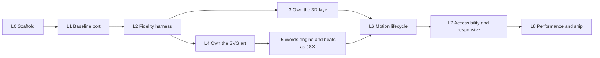

# Treecord landing — Development phases

**Track:** L0–L8 · **Target:** the `/landing/` prototype (`src/generated/prototype/landing/`), cloned in full: every beat, motion, asset and
behaviour · **Inputs:** [`src/generated/prototype/landing/README.md`](src/generated/prototype/landing/README.md), [`../foundation.md`](../foundation.md),
[`../landing-research.md`](../landing-research.md), [`../docs/FE/fe-stack.md`](../docs/FE/fe-stack.md),
[`../docs/FE/lint.md`](../docs/FE/lint.md), [`../docs/strict-rules.md`](../docs/strict-rules.md)

The landing (S1) was left out of the app plan ([`../docs/phases.md`](../docs/phases.md) §0.2). This file is its plan.
`landing-app/` started as a 1:1 TypeScript port that borrowed the prototype's asset folders at runtime. The
phases below move everything it borrows into the app as typed code that React owns, without changing what a visitor
sees or does. **Done means it works locally** and looks like the prototype side by side, at the same scroll point, in
the same browser.

> **Status: complete.** Every phase is built and verified in headless Chromium (the user accepted that as the
> validation). The original `landing/`, `svg-assets/` and `three-assets/` folders have been removed; this app is the
> source of truth. A frozen copy of the prototype lives in [`src/generated/prototype/`](src/generated/prototype/README.md)
> (a folder pspt's lint config ignores, like the backend's frozen files): the unit tests use it as an oracle, and
> `npm run e2e:fidelity` serves it as the reference page. Paths below that name `svg-assets`, `three-assets` or
> `landing` refer to that copy.

---

## 0. Decisions

### 0.1 Decided for this plan

| Id   | Decision                                                                                                                                                                                                                                           | Source                                                                                   |
| ---- | -------------------------------------------------------------------------------------------------------------------------------------------------------------------------------------------------------------------------------------------------- | ---------------------------------------------------------------------------------------- |
| L-1  | The clone target is the **prototype as it runs**, not `foundation.md`. Where they differ, the prototype wins; the differences are listed in §0.3                                                                                                   | User, 24 Oct 2026 ("clone full functionality and UI/UX")                                 |
| L-2  | Fidelity is **similar, checked by eye**, not pixel-identical, the same bar the app uses ([`../docs/FE/fe-stack.md`](../docs/FE/fe-stack.md) §4). Tests verify behaviour: which beat shows, in which order, with which copy, links and states       | User decision for the app, 23 Oct 2026, applied here                                     |
| L-3  | Copy is **verbatim** from `svg-assets/src/story.js`, the landing's approved copy. Nothing is reworded; a missing sentence ships as Lorem ipsum (conventions §9)                                                                                    | [`../foundation.md`](../foundation.md) §3                                                |
| L-4  | TypeScript strict, pspt `react` toolchain copied byte for byte, `npm run check` green on every commit (SR-3, SR-5)                                                                                                                                 | [`../docs/strict-rules.md`](../docs/strict-rules.md)                                     |
| L-5  | `tests/` mirrors `src/` (SR-2); `<source>.test.ts(x)` for unit, `<journey>.spec.ts` for end to end; no test is skipped or weakened to reach green                                                                                                  | Conventions §8, SR-2, SR-5                                                               |
| L-6  | Library versions stay the prototype's: three 0.186.1, gsap 3.15.0 (SplitText, DrawSVG, MotionPath, ScrambleText)                                                                                                                                   | [`src/generated/prototype/landing/README.md`](src/generated/prototype/landing/README.md) |
| L-7  | The prototype's previews (`svg-assets/index.html`, `three-assets/index.html`) keep their own copies. The app takes a copy in L3/L4 and stops importing from outside `landing-app/`                                                                 | Plan                                                                                     |
| L-8  | `landing-app/` is **its own git repository** (like `frontend/`), so its husky hooks never touch the root repo's `core.hooksPath`. Hooks are active through `npm run prepare`                                                                       | User, 24 Oct 2026 (was O-1)                                                              |
| L-9  | Beats are **JSX components**: React owns the markup, no `dangerouslySetInnerHTML`, every sentence greppable in one copy file (L5)                                                                                                                  | User, 24 Oct 2026 (was O-2)                                                              |
| L-10 | Without JavaScript the story still reads: `index.html` is **prerendered at build** (one static route), and JS only animates (L7)                                                                                                                   | User, 24 Oct 2026 (was O-3)                                                              |
| L-11 | Both CTAs read from **one `LINKS` constant**. It keeps the prototype's mockup hash routes until the landing is hosted next to the app, then takes the app's path routes ([`../docs/FE/fe-architecture.md`](../docs/FE/fe-architecture.md) §6) (L8) | User, 24 Oct 2026 (was O-4)                                                              |

### 0.2 Open

None. O-1 to O-4 were settled as L-8 to L-11.

### 0.3 In `foundation.md` but not in the prototype: out of this plan

| Item                                             | foundation.md | Comes back when                                                            |
| ------------------------------------------------ | ------------- | -------------------------------------------------------------------------- |
| Snap to beats (`labelsDirectional`)              | §4.3, §6.3    | The user tries it on a real device and asks for it                         |
| Dot rail with `aria-current`, click to jump      | §4.5          | Same; the prototype has a 3 px progress bar instead                        |
| Cursor parallax on the hero                      | §3 B0         | Same                                                                       |
| Two CTAs in the hero                             | §3 B0         | Same; the prototype puts both CTAs in the roles beat                       |
| Unpinned "after" section (roles scroll normally) | §1, §4.2      | Same; the prototype keeps roles inside the pin and only the footer scrolls |
| Indonesian copy                                  | §6.1          | A translated `story` is approved                                           |

> Written down so each one stops coming back as a fresh idea mid-phase.

### 0.4 Folder structure

The app follows [`../docs/FE/fe-architecture.md`](../docs/FE/fe-architecture.md) §2: the landing is the `landing`
feature, shared pieces live in `shared/`, and `tests/` mirrors `src/` exactly (SR-2, checked by
`npm run check:parity`).

```
src/
  main.tsx                          root: global styles, the page
  styles.css                        the prototype's CSS (the design)
  features/landing/
    landing.page.tsx                route component: skeleton, mounts the story
    landing.copy.ts                 every sentence; landing.links.ts the CTAs ← svg-assets/src/story.js
    story.ts                        master timeline, ScrollTrigger, mount/teardown
    beats/*.tsx                     the eight beats: a component and its timeline each
    camera.ts                       poses and the moves between beats
    stage3d.ts                      the 3D stage; rig; render loop
    three/                          forest, ground, tree, hero tree, carbon, sky (L3)  ← three-assets/src
    words/                          rich marks, scribbles, script/greet               ← svg-assets/src/words.js
    helpers.ts  types.ts
  shared/
    art/                            SVG art and icons, each with its timeline (L4)     ← svg-assets/src
    motion/env.ts                   reduced-motion and mobile flags (pause-motion joins in L6)
tests/
  unit/                             mirrors src/
  e2e/                              <journey>.spec.ts, Chromium
  helpers/setup.ts                  jsdom gaps
scripts/check-parity.ts             SR-2
```

Rules that follow from it: a page component wires, presentational components take props; copy lives in
`landing.copy.ts` and never inline; a `*.rules.ts` file, if the landing needs one, is pure (SR-7); no chained JSX
ternary (use a `const` map).

---

## 1. Phase map



| Phase | Goal                                                                  | Can run with |
| ----- | --------------------------------------------------------------------- | ------------ |
| L0    | Toolchain, TypeScript, test runner                                    | —            |
| L1    | The prototype runs unchanged inside a React + Vite shell              | —            |
| L2    | A side-by-side harness that every later phase is checked against      | —            |
| L3    | `three-assets` becomes typed app code                                 | L4           |
| L4    | `svg-assets` art becomes typed app code                               | L3           |
| L5    | Copy, words engine and beats owned by React                           | —            |
| L6    | Reduced motion, resize and unmount handled without reloads            | —            |
| L7    | Readable and usable at every viewport, with motion off and without JS | —            |
| L8    | Small, fast, and linked into the site                                 | —            |

---

## Phase L0 — Scaffold and toolchain

**Goal:** `npm run check` and `npm test` are green on an empty-but-real app, under pspt's exact toolchain.

| Area       | Files                                                                                                                                                     |
| ---------- | --------------------------------------------------------------------------------------------------------------------------------------------------------- |
| Toolchain  | `package.json`, `eslint.config.mjs`, `knip.json`, `.prettierrc.json`, `.prettierignore`, `commitlint.config.mjs`, `.husky/` (pspt `react`, byte for byte) |
| TypeScript | `tsconfig.json` (`strict`), `vite.config.ts` (React plugin, Vitest block)                                                                                 |
| Tests      | `tests/helpers/setup.ts` (jsdom gaps: `matchMedia`, `document.fonts`)                                                                                     |

### Exit criteria

- [x] `npm run check` (`prettier --check`, `eslint --max-warnings=0`, `tsc --noEmit`, `knip`) passes; `fix-flow.mjs .` reports the `react` set with no drift
- [x] `npm test` runs Vitest 5 in jsdom with Testing Library
- [x] `npm run check:parity` fails when a file under `tests/unit/` has no matching source under `src/` (SR-2) — `scripts/check-parity.ts`
- [x] L-8: hooks active (`git config core.hooksPath` is `.husky/_` in the `landing-app/` repo), and a commit with a co-author trailer is rejected (SR-6)
- [x] Playwright 1.64 with Chromium installed and `npm run e2e` runs a smoke spec (stage mounts, canvas, no console error) (SR-4)

## Phase L1 — Baseline port

**Goal:** the prototype's story runs inside React + Vite in TypeScript, with the same beats, timings and camera.

| Area   | Files                                                                                                                                                                                        |
| ------ | -------------------------------------------------------------------------------------------------------------------------------------------------------------------------------------------- |
| Shell  | `index.html`, `src/main.tsx`, `src/styles.css` (the prototype's CSS, unchanged)                                                                                                              |
| Story  | `src/features/landing/Landing.tsx`, `story.ts` (master timeline + ScrollTrigger), `beats.ts`, `camera.ts` (poses, moves), `stage3d.ts`, `helpers.ts`, `src/shared/motion/env.ts`, `types.ts` |
| Bridge | `vite.config.ts` resolves bare imports from `src/generated/prototype/svg-assets` and `src/generated/prototype/three-assets` (removed in L3/L4)                                               |

### Exit criteria

- [x] Eight beats in the prototype's order (hero, seedling, problems, proof, pipeline, survival, carbon, roles); only the hero has no entering move — `tests/unit/features/landing/beats.test.ts`
- [x] Every beat has a camera pose; zoom in/out settle the incoming beat at scale 1 and fade the outgoing one; pans push the outgoing beat ±100% — `tests/unit/features/landing/camera.test.ts`
- [x] `place()` unpauses an asset timeline and stretches it to its slot; `pick()` throws naming a missing selector — `tests/unit/features/landing/helpers.test.ts`
- [x] The React page renders the skip link, one section per beat and the footer, mounts the story once fonts are ready and tears it down on unmount — `tests/unit/features/landing/Landing.test.tsx`
- [x] `vite build` succeeds; dev load shows the canvas, the pinned stage and no console error
- [x] Compared in pairs by eye (L-2): all eight beats at 1440×900, and the proof, pipeline, survival and roles beats at 390×844, rendered at the same point in the prototype and the app. Only time-based motion (clouds, leaves, sway, the coin's spin) and the scrambling characters differ. A continuous scroll on a real device is the one open item in L8

## Phase L2 — Fidelity harness

**Goal:** one command shows the prototype and the app at the same scroll point, so every later phase is checked
against the same baseline instead of memory.

| Area     | Files                                                                                   |
| -------- | --------------------------------------------------------------------------------------- |
| Servers  | `playwright.config.ts`: the prototype served from `..` (`/landing/`), the app from Vite |
| Journeys | `tests/e2e/landing.spec.ts`, `tests/helpers/story.ts`                                   |
| Review   | `tests/e2e/fidelity.spec.ts` writes paired screenshots to `test-results/fidelity/`      |

### Exit criteria

- [x] For every beat at progress 0, 0.5 and 1 (`?at=<beat>,<p>`) and for the seven camera moves at `-0.2`, a screenshot pair (prototype | app) is written at 1440×900, 1000×560 and 390×844 — `tests/e2e/fidelity.spec.ts`, run with `npm run e2e:fidelity` (93 pairs, about 30 minutes in software WebGL; it is its own Playwright project so `npm run e2e` stays fast). Checked on `survival` at 0.5: layout, headline mark, panel and track match; only time-based motion (clouds, leaves, sway) differs
- [x] At the middle of each beat exactly that one beat is on screen (shown, not faded, centred in the viewport), and a top-to-bottom scroll grows the rail's `scaleX` without ever shrinking and ends full — `tests/e2e/landing.spec.ts`
- [x] A full scroll logs no console error or page error in Chromium — `tests/e2e/landing.spec.ts`
- [x] The two CTAs keep the prototype's `href` values until L8 switches them (L-11) — `tests/e2e/landing.spec.ts`

> The harness lands before any rewrite. L3–L7 each end with "the L2 pairs still match by eye", which is only cheap
> when the pairs already exist.

## Phase L3 — Own the 3D layer

**Goal:** the forest, ground, sky, hero tree and carbon particles are typed app code that the stage builds from;
`stage3d.ts` imports nothing from `src/generated/prototype/three-assets`.

| Area        | Files                                                                                                                                                                                                                            |
| ----------- | -------------------------------------------------------------------------------------------------------------------------------------------------------------------------------------------------------------------------------- |
| Scene parts | `src/features/landing/three/palette.ts`, `random.ts`, `tree.ts` (shared shader uniforms), `ground.ts`, `forest.ts`, `hero-tree.ts`, `carbon.ts`, and the sky as four files: `clouds.ts`, `mountains.ts`, `birds.ts`, `leaves.ts` |
| World       | `three/world.ts`: the parts, the light and the fog as pure three.js, so the budgets can be tested without a GPU                                                                                                                  |
| Stage       | `src/features/landing/stage3d.ts` keeps the renderer, camera and frame loop; the two `as never` casts are gone                                                                                                                   |
| Tests       | `tests/unit/features/landing/three/*.test.ts`, one per file; each compares against the prototype's own module as an oracle (same seed, same output)                                                                              |

### Exit criteria

- [x] `mulberry32`, `hash3`, `smoothstep` and `scatter` give the prototype's output for the same seed, so the forest layout is identical — `tests/unit/features/landing/three/random.test.ts`
- [x] `heightAt(x, z)` matches the prototype's at sample points and the ground mesh matches vertex for vertex; the forest has the same trees, instance matrices, growth delays and crown tops, and keeps the hero tree's clearing — `ground.test.ts`, `forest.test.ts`
- [x] Tree geometry (broadleaf and conifer, several seeds) and the three shader modes match the prototype's; the hero tree, carbon particles, clouds, mountains, birds and leaves match too — `tree.test.ts`, `hero-tree.test.ts`, `carbon.test.ts`, `clouds.test.ts`, `mountains.test.ts`, `birds.test.ts`, `leaves.test.ts`
- [x] Every scene part's options and return are typed; `tsc` passes with no cast at any call site
- [x] Budgets from [`../foundation.md`](../foundation.md) §5: every mesh and point cloud is one draw call and there are far fewer than 100; at most 3 lights; no shadow map — `three/world.test.ts`
- [x] `dispose()` lets go of every geometry and material in the scene — `three/world.test.ts`
- [x] Mobile load: at most 1,200 trees, 1,200 particles, fewer clouds, birds and leaves, DPR capped at 1.5, no antialias — `three/world.test.ts`
- [x] Losing the WebGL context shows the plain paper background and the story still scrolls — `tests/e2e/context-loss.spec.ts` (this found that three sets `display` inline, which beat the `.gl-lost` rule; the prototype has the same defect, fixed here in the handler)
- [x] `vite.config.ts` no longer needs the bridge for `three`; it stays for `gsap` until L4 moves the SVG art. The L2 pairs for the hero and carbon beats match by eye
- [x] Under StrictMode (mount, unmount, mount) exactly one canvas remains — `tests/e2e/landing.spec.ts` (the smoke test asserts one canvas); heap growth across remounts is measured in L8
- [x] The render loop stops while the stage is off screen and resumes on return — `tests/e2e/render-loop.spec.ts` (counts the page's real WebGL draw calls, on a viewport shorter than the footer so the stage scrolls fully out of view)

> **A review jump skips the load intro.** `?at=<beat>,<progress>` now shows a beat settled, without the forest's 3.2 s
> growth, because under software WebGL the intro stretched past any fixed wait (GSAP's lag smoothing slows time when
> frames are slow) and the early screenshots caught a half-grown forest.

## Phase L4 — Own the SVG art

**Goal:** every SVG asset a beat uses, and its timeline, is typed app code; `beats.ts` imports no art from
`src/generated/prototype/svg-assets`. What still comes from there is the story copy and the words engine, which L5 moves.

| Area                | Files                                                                                                                                                                                                                |
| ------------------- | -------------------------------------------------------------------------------------------------------------------------------------------------------------------------------------------------------------------- |
| Primitives          | `src/shared/art/lowpoly.ts` (polygons, fans, blobs, leaves, limbs, `nest`; geometry is written as point strings such as `'22,70 74,70'`), `timeline.ts` (named eases, the "finish at 1" marker), `src/shared/dom.ts` |
| Story objects       | `coin.ts`, `blind-funding.ts`, `certificate.ts`, `phone.ts`, `shield.ts`, `serial.ts`, `logo.ts`                                                                                                                     |
| Scenes and diagrams | `forgotten.ts`, `field-check.ts`, `pipeline.ts`, `milestones.ts`, `icons.ts`                                                                                                                                         |
| Moved to `shared/`  | `src/shared/random.ts` and `src/shared/palette.ts`, now used by both the 3D layer and the art                                                                                                                        |
| Tests               | `tests/unit/shared/art/*.test.ts`, one per file, each against the prototype's own module; `tests/helpers/timelines.ts` turns a timeline into comparable data                                                         |

Not ported, because no beat uses them: `tree.js` (the 3D hero tree replaces it), the GPS pin, `coinTimeline`, and
`PHONE_VIEWBOX`. They stay in `svg-assets/` for its own preview page.

### Exit criteria

- [x] Each asset draws the same markup as the prototype, byte for byte: root class, `viewBox`, ids and every facet — `tests/unit/shared/art/*.test.ts`
- [x] Each asset timeline has the same tweens at the same times, on the same targets with the same vars, and is paused and at least 1 long (the certificate runs to 1.1, as in the prototype) — `tests/unit/shared/art/*.test.ts`
- [x] The proof rows, serial and meta line, and every visible string in the art are unchanged (L-3); custom proof rows, serials and coin tones render like the prototype's
- [x] Decorative SVGs carry `aria-hidden` and `focusable="false"`; the meaning is in the DOM text
- [x] The L2 pairs for the problems, proof, pipeline and roles beats match by eye (only time-based motion and the scrambling characters differ)
- [x] Every asset's SVG stays under 1,000 nodes (the pipeline, the largest, is far inside it), and no path is morphed: MorphSVG is not used — `tests/unit/shared/art/art.test.tsx`
- [x] The app no longer reaches `svg-assets/` for art or words; the Vite bridge for their bare imports now applies in test mode only, for the oracle tests (L5)

## Phase L5 — Words engine and beats as JSX

**Goal:** the copy, the masked line reveals, the hand-drawn marks and every beat's markup are React's (L-9).

| Area  | Files                                                                                                                                                                                                   |
| ----- | ------------------------------------------------------------------------------------------------------------------------------------------------------------------------------------------------------- |
| Copy  | `src/features/landing/landing.copy.ts`: the approved script verbatim (marks included) plus the shell strings; `landing.links.ts`: the two CTA targets                                                   |
| Words | `words/rich.rules.ts` (pure: marks to pieces), `words/rich.tsx` (`Rich`, `Copy`), `words/marks.ts` (hand-drawn marks, one function per kind), `words/script.ts` (`prepare`, `speak`, `script`, `greet`) |
| Beats | `beats/hero.tsx`, `seedling.tsx`, `problems.tsx`, `proof.tsx`, `pipeline.tsx`, `survival.tsx`, `carbon.tsx`, `roles.tsx`, each with its `build` timeline beside it; `beats/index.ts` lists them         |
| Art   | `src/shared/art/art.tsx`: mounts a generator's `<svg>` as parsed SVG inside a space-free wrapper                                                                                                        |

### Exit criteria

- [x] `rich` turns every mark kind into the prototype's DOM, byte for byte, and `parseRich` splits text, marks, swaps and step numbers — `tests/unit/features/landing/words/rich.test.tsx`, `rich.rules.test.ts`
- [x] `script()` returns the time each line has really been read and its `end`, for a null greeting and numeric cues; `marks` and `greet` match the prototype's overlay markup and tweens — `words/script.test.ts`, `words/marks.test.ts`
- [x] Every sentence on the page comes from `landing.copy.ts` (the story word for word, plus the shell: skip link, label, wordmark, footer); no visible string is inline in a component — `landing.copy.test.ts`, `landing.page.test.tsx`
- [x] No `dangerouslySetInnerHTML` left in `src/`; each beat is a component, its section id is unchanged, and it renders everything its timeline looks up — `tests/unit/features/landing/beats/index.test.tsx`
- [x] Line masks keep descenders and raised step numbers (the `.ln-mask` padding is unchanged) — checked by eye in the hero, seedling and survival pairs
- [x] The app imports nothing from `src/generated/prototype/svg-assets` or `src/generated/prototype/three-assets`. Only the unit tests do, to load the prototype as an oracle, so the Vite bridge now applies in test mode only
- [ ] The art as JSX components: `Art` mounts the generators' strings, which are byte-identical to the prototype's and tested; one JSX component per asset is the upgrade path (`ponytail:` in `art.tsx`)

## Phase L6 — Motion lifecycle

**Goal:** motion follows the visitor's settings and the window live, with no page reload and no leak.

| Area   | Files                                                                                                                                                                                                |
| ------ | ---------------------------------------------------------------------------------------------------------------------------------------------------------------------------------------------------- |
| Motion | `src/shared/motion/env.ts`: the reduced-motion setting read live, and a watcher; `story.ts`: the WebGL stage lives for the visit, the story is built by `buildStory()`, which returns what undoes it |
| Resize | A real width change (more than 40 px) rebuilds the story in place; the reload is gone                                                                                                                |

### Exit criteria

- [x] Turning reduced motion on while the page is open removes the pin and the scrub and shows every beat as an article; turning it off restores the story at the hero — `tests/e2e/motion.spec.ts`
- [x] Resizing from 1440 to 1000 px wide re-measures lines and marks without reloading (same `timeOrigin`), and the mark layers are rebuilt, not duplicated — `tests/e2e/motion.spec.ts`
- [x] Rotating a 390×844 phone to landscape recomputes the scroll length, and the story still reaches its end — `tests/e2e/motion.spec.ts`
- [x] React StrictMode is on; the dev double mount builds the story exactly once and tears it down once — `landing.page.test.tsx`
- [x] The hook greets on load before any scroll — `tests/e2e/motion.spec.ts`
- [x] `?at=<beat>,<p>` jumps for review, and only in development builds (`import.meta.env.DEV`); the production gate is checked on the build preview in L8
- [x] The reduced-motion setting and its live watcher — `tests/unit/shared/motion/env.test.ts`

## Phase L7 — Accessibility and responsive

**Goal:** everyone can read the whole story: keyboard, screen reader, motion off, small screens, no JavaScript.

| Area       | Files                                                                                                                                                                                    |
| ---------- | ---------------------------------------------------------------------------------------------------------------------------------------------------------------------------------------- |
| Semantics  | The hook is the `h1` and each beat opens with an `h2` (`Copy`'s `heading` prop); the footer takes focus from the skip link (`tabIndex={-1}`); SplitText labels only headings             |
| Visibility | In the pinned layout a beat is hidden by opacity, not `visibility`, so every beat and headline stays in the accessibility tree; a button is clickable only once its beat has revealed it |
| No JS      | `landing.view.tsx` is the pure markup; a build-only Vite plugin renders it into `index.html`, and the client adds `data-motion` on mount                                                 |
| Preview    | `npm run e2e:preview` builds the site and tests it as a visitor gets it                                                                                                                  |

### Exit criteria

- [x] "Skip the story" is the first focusable element and moves focus to the footer — `tests/e2e/a11y.spec.ts`
- [x] Canvas and art are `aria-hidden`; the reading order is the story order; the headlines form one outline (h1, then one h2 per beat and per problem panel); axe finds no serious or critical violation in the pinned story (first and last beat) or in the reduced-motion article — `a11y.spec.ts`
- [x] Every beat is in the accessibility tree whichever beat is on screen — `a11y.spec.ts`
- [x] Page Down moves through the story with native scrolling; no scroll is hijacked — `a11y.spec.ts`
- [x] The calls to action show a 3 px focus ring when tabbed to — `a11y.spec.ts`. Contrast on the glass panel is covered by axe's colour-contrast rule (serious) in the last-beat scan
- [x] No horizontal page scroll at 360 px and 1920 px on any beat (NFR-034); at 1000×560 the pipeline is height-bound and sits below its headline; a headline's layer is above a glass panel's; on a phone the two-column beats become one column — `tests/e2e/responsive.spec.ts`
- [x] L-10: with JavaScript off the beats read top to bottom as an article with the same text, the two links and the footer are there, and nothing scrolls sideways — `tests/e2e/preview/no-js.spec.ts`
- [x] Resizing or rotating keeps the visitor's place in the story (found by the rotation test: the pin is taken away and put back, and the browser clamps the scroll in between) — `tests/e2e/motion.spec.ts`

> **Two notes.** SplitText's default `aria-label` on a split line is only valid on a heading, so a plain paragraph keeps
> its split words readable instead (axe flagged it, `script.test.ts` pins the behaviour). The prerendered article has no
> illustrations: the art is mounted by the client, and it is decorative.

## Phase L8 — Performance and ship

**Goal:** the headline paints first, the bundle is split, and the landing is ready to be linked into the site.

| Area    | Files                                                                                                                                                                                    |
| ------- | ---------------------------------------------------------------------------------------------------------------------------------------------------------------------------------------- |
| Loading | `rig.ts` (the camera state as plain numbers), `story.ts` builds the story at once and loads `stage3d.ts` (and three.js) as separate chunks afterwards                                    |
| Release | `stage3d.ts` releases its WebGL context on dispose, and a new stage starts clean                                                                                                         |
| Links   | `landing.links.ts`: the two calls to action, hash routes by default, the app's path routes with `VITE_APP_ROUTES=path`                                                                   |
| Checks  | `scripts/check-build.ts` (chunk budgets, lazy 3D, font hints; run after `npm run build`), `scripts/check-debug.ts` (no `console.log`, `debugger` or ScrollTrigger markers in the source) |

### Exit criteria

- [x] three.js and the 3D layer load lazily, in their own chunks, after the text has painted: the first paint comes before the first WebGL draw call, the largest paint is the headline, and `index.html` loads neither chunk up front — `tests/e2e/preview/performance.spec.ts`, `check:build`
- [x] Chunk budgets: the app's own code is 406 kB and 27 kB (budget 500 kB each); three.js is its own 539 kB chunk (136 kB gzip), its floor, with a 560 kB limit so `vite build` prints no size warning — `npm run check:build`
- [x] The fonts preconnect to both hosts and use `display=swap`; the story mounts after `document.fonts.ready` — `check:build`
- [x] `?at=` is ignored by the production build — `tests/e2e/preview/no-js.spec.ts`
- [x] Five swaps of the 3D stage (reduced motion on and off) leave one canvas, one pin, no `gl-lost` state and under 30 MB of heap growth; each stage releases its WebGL context — `tests/e2e/lifecycle.spec.ts`
- [x] No `markers`, `console.log` or `debugger` in the source ([`../foundation.md`](../foundation.md) §5) — `npm run check:debug`
- [x] L-11: both calls to action read from one `LINKS` constant: the mockup's hash routes by default, the app's real path routes (`/campaigns`, `/sign-in?returnTo=%2Fapp`) when built with `VITE_APP_ROUTES=path`; never an external URL — `tests/unit/features/landing/landing.links.test.ts`
- [x] The original `/landing`, `svg-assets` and `three-assets` folders are removed: this app is the source of truth, and a frozen copy of the prototype stays in `src/generated/prototype/` as the test oracle and screenshot reference
- [x] **Accepted by the user:** headless Chromium (software WebGL) is the validation for the landing; a pass on a real laptop GPU and phone (frame rate, address-bar behaviour) is not required. It was not run, so frame rate and heat remain unmeasured.

> **Which routes ship.** `VITE_APP_ROUTES=path` is the setting for hosting the landing beside the app. It is off by
> default only because the landing is still standalone and the app does not exist yet to link to.
