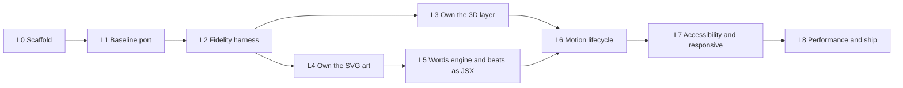

# Treecord landing — Development phases

**Track:** L0–L8 · **Target:** the `/landing/` prototype (`../landing/`), cloned in full: every beat, motion, asset and
behaviour · **Inputs:** [`../landing/README.md`](../landing/README.md), [`../foundation.md`](../foundation.md),
[`../landing-research.md`](../landing-research.md), [`../docs/FE/fe-stack.md`](../docs/FE/fe-stack.md),
[`../docs/FE/lint.md`](../docs/FE/lint.md), [`../docs/strict-rules.md`](../docs/strict-rules.md)

The landing (S1) was left out of the app plan ([`../docs/phases.md`](../docs/phases.md) §0.2). This file is its plan.
`landing-app/` starts as a 1:1 TypeScript port that still borrows `../svg-assets` and `../three-assets` at runtime. The
phases below move everything it borrows into the app as typed code that React owns, without changing what a visitor
sees or does. **Done means it works locally** and looks like the prototype side by side, at the same scroll point, in
the same browser.

---

## 0. Decisions

### 0.1 Decided for this plan

| Id   | Decision                                                                                                                                                                                                                                           | Source                                                   |
| ---- | -------------------------------------------------------------------------------------------------------------------------------------------------------------------------------------------------------------------------------------------------- | -------------------------------------------------------- |
| L-1  | The clone target is the **prototype as it runs**, not `foundation.md`. Where they differ, the prototype wins; the differences are listed in §0.3                                                                                                   | User, 24 Oct 2026 ("clone full functionality and UI/UX") |
| L-2  | Fidelity is **similar, checked by eye**, not pixel-identical, the same bar the app uses ([`../docs/FE/fe-stack.md`](../docs/FE/fe-stack.md) §4). Tests verify behaviour: which beat shows, in which order, with which copy, links and states       | User decision for the app, 23 Oct 2026, applied here     |
| L-3  | Copy is **verbatim** from `svg-assets/src/story.js`, the landing's approved copy. Nothing is reworded; a missing sentence ships as Lorem ipsum (conventions §9)                                                                                    | [`../foundation.md`](../foundation.md) §3                |
| L-4  | TypeScript strict, pspt `react` toolchain copied byte for byte, `npm run check` green on every commit (SR-3, SR-5)                                                                                                                                 | [`../docs/strict-rules.md`](../docs/strict-rules.md)     |
| L-5  | `tests/` mirrors `src/` (SR-2); `<source>.test.ts(x)` for unit, `<journey>.spec.ts` for end to end; no test is skipped or weakened to reach green                                                                                                  | Conventions §8, SR-2, SR-5                               |
| L-6  | Library versions stay the prototype's: three 0.186.1, gsap 3.15.0 (SplitText, DrawSVG, MotionPath, ScrambleText)                                                                                                                                   | [`../landing/README.md`](../landing/README.md)           |
| L-7  | The prototype's previews (`svg-assets/index.html`, `three-assets/index.html`) keep their own copies. The app takes a copy in L3/L4 and stops importing from outside `landing-app/`                                                                 | Plan                                                     |
| L-8  | `landing-app/` is **its own git repository** (like `frontend/`), so its husky hooks never touch the root repo's `core.hooksPath`. Hooks are active through `npm run prepare`                                                                       | User, 24 Oct 2026 (was O-1)                              |
| L-9  | Beats are **JSX components**: React owns the markup, no `dangerouslySetInnerHTML`, every sentence greppable in one copy file (L5)                                                                                                                  | User, 24 Oct 2026 (was O-2)                              |
| L-10 | Without JavaScript the story still reads: `index.html` is **prerendered at build** (one static route), and JS only animates (L7)                                                                                                                   | User, 24 Oct 2026 (was O-3)                              |
| L-11 | Both CTAs read from **one `LINKS` constant**. It keeps the prototype's mockup hash routes until the landing is hosted next to the app, then takes the app's path routes ([`../docs/FE/fe-architecture.md`](../docs/FE/fe-architecture.md) §6) (L8) | User, 24 Oct 2026 (was O-4)                              |

### 0.2 Open

None. O-1 to O-4 were settled as L-8 to L-11.

### 0.3 In `foundation.md` but not in the prototype: out of this plan

| Item                                             | foundation.md | Comes back when                                                            |
| ------------------------------------------------ | ------------- | -------------------------------------------------------------------------- |
| Snap to beats (`labelsDirectional`)              | §4.3, §6.3    | The user tries it on a real device and asks for it                         |
| Dot rail with `aria-current`, click to jump      | §4.5          | Same; the prototype has a 3 px progress bar instead                        |
| Cursor parallax on the hero                      | §3 B0         | Same                                                                       |
| Two CTAs in the hero                             | §3 B0         | Same; the prototype puts both CTAs in the roles beat                       |
| Unpinned "after" section (roles scroll normally) | §1, §4.2      | Same; the prototype keeps roles inside the pin and only the footer scrolls |
| Indonesian copy                                  | §6.1          | A translated `story` is approved                                           |

> Written down so each one stops coming back as a fresh idea mid-phase.

### 0.4 Folder structure

The app follows [`../docs/FE/fe-architecture.md`](../docs/FE/fe-architecture.md) §2: the landing is the `landing`
feature, shared pieces live in `shared/`, and `tests/` mirrors `src/` exactly (SR-2, checked by
`npm run check:parity`).

```
src/
  main.tsx                          root: global styles, the page
  styles.css                        the prototype's CSS (the design)
  features/landing/
    landing.page.tsx                route component: skeleton, mounts the story
    landing.copy.ts                 every sentence (L5)                   ← svg-assets/src/story.js
    story.ts                        master timeline, ScrollTrigger, mount/teardown
    beats.ts  →  beats/*.tsx        the eight beats (L5)
    camera.ts                       poses and the moves between beats
    stage3d.ts                      the 3D stage; rig; render loop
    three/                          forest, ground, tree, hero tree, carbon, sky (L3)  ← three-assets/src
    words/                          rich marks, scribbles, script/greet (L5)           ← svg-assets/src/words.js
    helpers.ts  types.ts
  shared/
    art/                            SVG art and icons, each with its timeline (L4)     ← svg-assets/src
    motion/env.ts                   reduced-motion and mobile flags (pause-motion joins in L6)
tests/
  unit/                             mirrors src/
  e2e/                              <journey>.spec.ts, Chromium
  helpers/setup.ts                  jsdom gaps
scripts/check-parity.ts             SR-2
```

Rules that follow from it: a page component wires, presentational components take props; copy lives in
`landing.copy.ts` and never inline; a `*.rules.ts` file, if the landing needs one, is pure (SR-7); no chained JSX
ternary (use a `const` map).

---

## 1. Phase map



| Phase | Goal                                                                  | Can run with |
| ----- | --------------------------------------------------------------------- | ------------ |
| L0    | Toolchain, TypeScript, test runner                                    | —            |
| L1    | The prototype runs unchanged inside a React + Vite shell              | —            |
| L2    | A side-by-side harness that every later phase is checked against      | —            |
| L3    | `three-assets` becomes typed app code                                 | L4           |
| L4    | `svg-assets` art becomes typed app code                               | L3           |
| L5    | Copy, words engine and beats owned by React                           | —            |
| L6    | Reduced motion, resize and unmount handled without reloads            | —            |
| L7    | Readable and usable at every viewport, with motion off and without JS | —            |
| L8    | Small, fast, and linked into the site                                 | —            |

---

## Phase L0 — Scaffold and toolchain

**Goal:** `npm run check` and `npm test` are green on an empty-but-real app, under pspt's exact toolchain.

| Area       | Files                                                                                                                                                     |
| ---------- | --------------------------------------------------------------------------------------------------------------------------------------------------------- |
| Toolchain  | `package.json`, `eslint.config.mjs`, `knip.json`, `.prettierrc.json`, `.prettierignore`, `commitlint.config.mjs`, `.husky/` (pspt `react`, byte for byte) |
| TypeScript | `tsconfig.json` (`strict`), `vite.config.ts` (React plugin, Vitest block)                                                                                 |
| Tests      | `tests/helpers/setup.ts` (jsdom gaps: `matchMedia`, `document.fonts`)                                                                                     |

### Exit criteria

- [x] `npm run check` (`prettier --check`, `eslint --max-warnings=0`, `tsc --noEmit`, `knip`) passes; `fix-flow.mjs .` reports the `react` set with no drift
- [x] `npm test` runs Vitest 5 in jsdom with Testing Library
- [x] `npm run check:parity` fails when a file under `tests/unit/` has no matching source under `src/` (SR-2) — `scripts/check-parity.ts`
- [x] L-8: hooks active (`git config core.hooksPath` is `.husky/_` in the `landing-app/` repo), and a commit with a co-author trailer is rejected (SR-6)
- [x] Playwright 1.64 with Chromium installed and `npm run e2e` runs a smoke spec (stage mounts, canvas, no console error) (SR-4)

## Phase L1 — Baseline port

**Goal:** the prototype's story runs inside React + Vite in TypeScript, with the same beats, timings and camera.

| Area   | Files                                                                                                                                                                                        |
| ------ | -------------------------------------------------------------------------------------------------------------------------------------------------------------------------------------------- |
| Shell  | `index.html`, `src/main.tsx`, `src/styles.css` (the prototype's CSS, unchanged)                                                                                                              |
| Story  | `src/features/landing/Landing.tsx`, `story.ts` (master timeline + ScrollTrigger), `beats.ts`, `camera.ts` (poses, moves), `stage3d.ts`, `helpers.ts`, `src/shared/motion/env.ts`, `types.ts` |
| Bridge | `vite.config.ts` resolves bare imports from `../svg-assets` and `../three-assets` (removed in L3/L4)                                                                                         |

### Exit criteria

- [x] Eight beats in the prototype's order (hero, seedling, problems, proof, pipeline, survival, carbon, roles); only the hero has no entering move — `tests/unit/features/landing/beats.test.ts`
- [x] Every beat has a camera pose; zoom in/out settle the incoming beat at scale 1 and fade the outgoing one; pans push the outgoing beat ±100% — `tests/unit/features/landing/camera.test.ts`
- [x] `place()` unpauses an asset timeline and stretches it to its slot; `pick()` throws naming a missing selector — `tests/unit/features/landing/helpers.test.ts`
- [x] The React page renders the skip link, one section per beat and the footer, mounts the story once fonts are ready and tears it down on unmount — `tests/unit/features/landing/Landing.test.tsx`
- [x] `vite build` succeeds; dev load shows the canvas, the pinned stage and no console error
- [ ] Scrolled top to bottom in a real browser beside the prototype, every beat looks and moves the same (by eye, L-2)

## Phase L2 — Fidelity harness

**Goal:** one command shows the prototype and the app at the same scroll point, so every later phase is checked
against the same baseline instead of memory.

| Area     | Files                                                                                   |
| -------- | --------------------------------------------------------------------------------------- |
| Servers  | `playwright.config.ts`: the prototype served from `..` (`/landing/`), the app from Vite |
| Journeys | `tests/e2e/landing.spec.ts`, `tests/helpers/story.ts`                                   |
| Review   | `tests/e2e/fidelity.spec.ts` writes paired screenshots to `test-results/fidelity/`      |

### Exit criteria

- [x] For every beat at progress 0, 0.5 and 1 (`?at=<beat>,<p>`) and for the seven camera moves at `-0.2`, a screenshot pair (prototype | app) is written at 1440×900, 1000×560 and 390×844 — `tests/e2e/fidelity.spec.ts`, run with `npm run e2e:fidelity` (93 pairs, about 30 minutes in software WebGL; it is its own Playwright project so `npm run e2e` stays fast). Checked on `survival` at 0.5: layout, headline mark, panel and track match; only time-based motion (clouds, leaves, sway) differs
- [x] At the middle of each beat exactly that one beat is on screen (shown, not faded, centred in the viewport), and a top-to-bottom scroll grows the rail's `scaleX` without ever shrinking and ends full — `tests/e2e/landing.spec.ts`
- [x] A full scroll logs no console error or page error in Chromium — `tests/e2e/landing.spec.ts`
- [x] The two CTAs keep the prototype's `href` values until L8 switches them (L-11) — `tests/e2e/landing.spec.ts`

> The harness lands before any rewrite. L3–L7 each end with "the L2 pairs still match by eye", which is only cheap
> when the pairs already exist.

## Phase L3 — Own the 3D layer

**Goal:** the forest, ground, sky, hero tree and carbon particles are typed app code; nothing is imported from
`../three-assets`.

| Area        | Files                                                                                                                                                                                        |
| ----------- | -------------------------------------------------------------------------------------------------------------------------------------------------------------------------------------------- |
| Scene parts | `src/features/landing/three/palette.ts`, `random.ts`, `tree.ts` (shared shader uniforms), `ground.ts`, `forest.ts`, `hero-tree.ts`, `carbon.ts`, `sky.ts` (clouds, mountains, birds, leaves) |
| Stage       | `src/features/landing/stage3d.ts` imports `src/features/landing/three/*`; the two `as never` casts are gone                                                                                  |
| Tests       | `tests/unit/features/landing/three/random.test.ts`, `ground.test.ts`, `forest.test.ts`                                                                                                       |

### Exit criteria

- [ ] `mulberry32`/`hash3` give the same sequence as the prototype for the same seed, so the forest layout is identical — `tests/unit/features/landing/three/random.test.ts`
- [ ] `heightAt(x, z)` matches the prototype's at sample points; the forest places `count` trees and exposes `tops` for the carbon particles — `tests/unit/features/landing/three/ground.test.ts`, `forest.test.ts`
- [ ] Every scene part's options and return are typed; `tsc` passes with no cast at any call site
- [ ] `dispose()` releases every geometry, material and the renderer, and stops the ticker; mounting and unmounting the stage five times leaves one canvas and no growing `renderer.info.memory` — `tests/e2e/landing.spec.ts`
- [ ] Budgets from [`../foundation.md`](../foundation.md) §5 hold: under 100 draw calls (`renderer.info.render.calls`) on every beat, at most 3 lights, no shadow map; the render loop stops while the stage is off screen — `tests/e2e/landing.spec.ts`
- [ ] Losing the WebGL context shows the plain paper background and the story still scrolls (`.gl-lost`) — `tests/e2e/landing.spec.ts`
- [ ] Mobile load (coarse pointer or ≤ 760 px): 1,200 trees, 1,200 particles, DPR ≤ 1.5, no antialias — `tests/unit/features/landing/stage3d.test.ts`
- [ ] `vite.config.ts` no longer needs the bridge for `three`; the L2 pairs still match by eye

## Phase L4 — Own the SVG art

**Goal:** every SVG asset and its timeline is typed app code; nothing is imported from `../svg-assets` except the copy
(moved in L5).

| Area                | Files                                                                                                                                                                                                        |
| ------------------- | ------------------------------------------------------------------------------------------------------------------------------------------------------------------------------------------------------------ |
| Objects             | `src/shared/art/objects.ts(x)`: logo, coin, blind funding, certificate, phone (`PHONE_VIEWBOX`, `PHONE_SCREEN_VIEWBOX`, proof rows), GPS, shield, serial                                                     |
| Scenes and diagrams | `src/shared/art/scenes.ts(x)` (forgotten seedling, field check), `src/shared/art/diagrams.ts(x)` (pipeline, milestones), `src/shared/art/icons.ts(x)`, `src/shared/art/lowpoly.ts`, `src/shared/art/tree.ts` |
| Tests               | `tests/unit/shared/art/*.test.ts(x)` mirroring each file                                                                                                                                                     |

### Exit criteria

- [ ] Each asset renders the same element tree as the prototype (same root class, `viewBox` and ids the timeline targets) — `tests/unit/shared/art/*.test.tsx`
- [ ] Each asset timeline is built paused, runs 0..1, and ends in the prototype's end state (drawn strokes, lit nodes, locked values) — `tests/unit/shared/art/*.test.ts`
- [ ] Proof rows, the serial's meta line and every visible string in the art come from one copy constant, unchanged (L-3)
- [ ] An SVG stays under about 1,000 nodes; a morphed path is a single `<path>` ([`../foundation.md`](../foundation.md) §5)
- [ ] Decorative SVGs are `aria-hidden`; the meaning is in the DOM text
- [ ] The L2 pairs still match by eye

## Phase L5 — Words engine and beats as JSX

**Goal:** the copy, the masked line reveals, the hand-drawn marks and every beat's markup are React's (L-9).

| Area  | Files                                                                                                                                                                                               |
| ----- | --------------------------------------------------------------------------------------------------------------------------------------------------------------------------------------------------- |
| Copy  | `src/features/landing/landing.copy.ts`: `story.js` verbatim, including the `{circle:…}`, `{num:…}`, `{swap:a\|b}` mark syntax                                                                       |
| Words | `src/features/landing/words/rich.tsx` (marks → spans), `src/features/landing/words/marks.ts` (scribble paths, DrawSVG), `src/features/landing/words/script.ts` (`speak`, `script`, `greet`, `HOLD`) |
| Beats | `src/features/landing/beats/Hero.tsx`, `Seedling.tsx`, `Problems.tsx`, `Proof.tsx`, `Pipeline.tsx`, `Survival.tsx`, `Carbon.tsx`, `Roles.tsx`, each with its `build` timeline beside it             |

### Exit criteria

- [ ] `rich()` turns every mark kind in the legend into the prototype's span shape (`.fx[data-fx]`, `.num`, strike + new) — `tests/unit/features/landing/words/rich.test.tsx`
- [ ] `script()` returns the time each line has really been read and its `end`, for `null` (already greeted) and numeric cues — `tests/unit/features/landing/words/script.test.ts`
- [ ] Every sentence on the page comes from `landing.copy.ts`; `grep` finds no visible string in a component (L-3)
- [ ] L-9: no `dangerouslySetInnerHTML` left in `src/`; each beat is a component and its section id is unchanged — `tests/unit/features/landing/beats/*.test.tsx`
- [ ] Line masks keep descenders and raised step numbers (`.ln-mask` padding) — by eye in the L2 pairs
- [ ] The words engine no longer imports `../svg-assets`; the Vite bridge plugin is deleted; the L2 pairs still match by eye

## Phase L6 — Motion lifecycle

**Goal:** motion follows the visitor's settings and the window live, with no page reload and no leak.

| Area   | Files                                                                                            |
| ------ | ------------------------------------------------------------------------------------------------ |
| Motion | `src/features/landing/story.ts` on `gsap.matchMedia()`; `useGSAP` from `@gsap/react` for scoping |
| Resize | SplitText `autoSplit` re-measures lines and marks; the `ponytail:` reload is deleted             |

### Exit criteria

- [ ] Turning reduced motion on while the page is open removes the pin and the scrub and shows every beat in its end state as an article; turning it off restores the story at the same beat — `tests/e2e/motion.spec.ts`
- [ ] Resizing from 1440 to 1000 px wide re-measures lines and marks without reloading (`performance.navigation` count unchanged) and the marks stay under their words — `tests/e2e/motion.spec.ts`
- [ ] Rotating a 390×844 viewport to landscape recomputes the pan distances (`invalidateOnRefresh`) — `tests/e2e/motion.spec.ts`
- [ ] React StrictMode is on; the double mount in dev leaves one canvas, one ScrollTrigger and unsplit text before the second build — `tests/unit/features/landing/Landing.test.tsx`
- [ ] The hook greets on load before any scroll, and the forest grows in over about 3 s (intro, not scroll) — `tests/e2e/landing.spec.ts`
- [ ] `?at=<beat>,<p>` still jumps for review, in development builds only — `tests/unit/features/landing/story.test.ts`

## Phase L7 — Accessibility and responsive

**Goal:** everyone can read the whole story: keyboard, screen reader, motion off, small screens, no JavaScript.

### Exit criteria

- [ ] "Skip the story" is the first focusable element and moves focus to the footer — `tests/e2e/a11y.spec.ts`
- [ ] Canvas and art are `aria-hidden`; the reading order is the story order; each beat's headline is a heading in one outline — `tests/e2e/a11y.spec.ts` (axe, no serious or critical violation)
- [ ] Space, PageDown and the arrow keys move through the story (native scroll, no scroll hijack) — `tests/e2e/a11y.spec.ts`
- [ ] CTAs have a visible focus ring (`--verified`, 3 px) and meet contrast on the glass panel
- [ ] No horizontal page scroll at 360 px and 1920 px (NFR-034); on 1000×560 the pipeline is height-bound and headlines sit above glass panels; on ≤ 760 px split beats stack — `tests/e2e/responsive.spec.ts`
- [ ] L-10: with JavaScript off the beats read top to bottom as an article with the same text — `tests/e2e/no-js.spec.ts`

## Phase L8 — Performance and ship

**Goal:** the headline paints first, the bundle is split, and the landing is linked into the site.

### Exit criteria

- [ ] Three.js and the 3D layer load lazily (`import()` in the effect), so the hero text paints before WebGL; the largest contentful paint is the headline — `tests/e2e/performance.spec.ts`
- [ ] No chunk over 500 kB after minification; `vite build` prints no size warning
- [ ] Fonts preconnect and use `display=swap`; the story mounts after `document.fonts.ready`, as now
- [ ] No `markers`, `console.log` or debug flag in the build ([`../foundation.md`](../foundation.md) §5)
- [ ] L-11: both CTAs point at the hosting site's real routes from one `LINKS` constant — `tests/e2e/landing.spec.ts`
- [ ] Checked on a real laptop GPU and a real phone (iPhone Safari, Android Chrome): smooth scrub, no address-bar jump (`svh`), forest renders ([`../landing/README.md`](../landing/README.md) "not yet tested on real devices")
- [ ] `../landing/` is marked superseded in its README, pointing here
